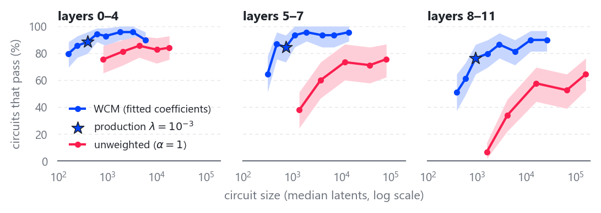

# What Makes a Latent Fire? Learning Weighted Circuits for Sparse Autoencoder Latents

Daniel Davies (Independent Researcher), Weibo Liu (Brunel University London)

*Two-page summary of the paper (draft, 2026-11-15; same text as `two-page-summary.tex`). Pointers in brackets give the paper section, table or figure for each number; they follow the paper build of 2026-11-15 and should be rechecked against the final PDF.*

## The idea

Circuit discovery usually explains an output: a logit, a probability, a behavioural metric. We ask instead what makes an *internal* sparse autoencoder (SAE) latent fire, and build *circuits for latents*. Targeting latents can capture variables that never show up as a token, and because latents are learned without labels, the model's activations, rather than the tasks we thought to pose, decide what gets explained [§1].

**Weighted circuit masking (WCM).** For a target latent, every latent at every upstream SAE site is a candidate node. WCM learns, for each one, a *gate* (is it in the circuit?) and a separate *scaling coefficient* α (how strongly does it act?); the sparsity penalty charges for membership only. The circuit is trained so that it reproduces the target's pre-activation when every other latent is ablated, under several ablations at once: zero (Z), the latent's sparsity-preserving mean over activating contexts (A) or over contrast contexts (C), and a resample term (R) that takes every non-member latent from a real contrast context, redrawn each step. The SAE reconstruction errors stay live, and downstream latents are recomputed, not clamped [§3.1–3.2, Figure 1].

**The test.** A circuit *passes* if, on held-out strongest activating contexts, its faithfulness under Z, A and C each lies in [0.75, 1.5] and its necessity (removing it removes the target) is at least 0.9. Sufficiency to induce, a *donor-background test* (everything outside the circuit takes a real donor context's code), and size-matched random circuits given the *same* coefficient fitting are reported but not required [§3.3].

## Result 1: circuits for sampled latents, at scale, on three models

We fit WCM at one sparsity penalty (λ = 10⁻³, 400 steps) to 8,000 sampled latents of TuringLLM (12 layers, trained on a documented synthetic corpus) and to 512 each of Pythia-70m and GPT-2 small with their public Top-K dictionaries; targets are sampled with no prioritisation heuristic [§4 setup].

- WCM finds a passing circuit for **88.0%** of 7,464 scored TuringLLM targets, **81.9%** of 508 Pythia-70m and **82.4%** of 511 GPT-2 small targets, with circuits of a median 609, 294 and 371 upstream latents [§4.1, Table 1]. Counting unscored and vacuous targets as fails gives 82%, 81% and 82%.
- Size-matched random circuits given the same coefficient fitting pass for none of the 366 targets tested, while the production circuits of the same targets pass for 83–86% [§4.1].
- Pass rates fall at depth and on weaker contexts: the deepest band passes least (82.3% at TuringLLM layers 8–11, 65.7% at GPT-2 small layers 8–11), circuits transfer only in part to weaker mid-band contexts (53.5%, 73.6%, 66.8%), and under real donor backgrounds 69.2%, 66.1% and 41.1% still pass [§4.1].
- The penalty was set on TuringLLM; a size-only rule fixed before a 30-target pilot kept it on both public models. This shows transfer, not optimality [§4.3].

## Result 2: the coefficients keep circuits small

Unweighted circuit masking is identical except that every α is fixed at 1. On a sweep of 173 scored TuringLLM targets (eight weighted and five unweighted penalties; figure below):

- At layers 8–11, target by target, the smallest passing unweighted circuit is a median **13.8×** larger than the smallest passing weighted one: **6,124** latents against **436**, over the 42 targets both methods pass. This is conservative, since it leaves out targets unweighted masking never passes [§4.2, Table 14].
- Unweighted circuits peak at 75.1% pass, at a median of 7.6 × 10⁴ latents, below WCM's 83.2% at λ = 10⁻³ [§4.2, Table 11].

The fitted coefficients are modest (median 1.0–1.1, 80% within 0.7–2.2), yet without them the same nodes almost never pass: setting every coefficient to 1 drops the pass rate from 88.0% to 1.8% (TuringLLM), 81.9% to 13.8% (Pythia-70m) and 82.4% to 3.3% (GPT-2 small) [§4.2, Table 13]. Since random circuits fail under the same fitting, the coefficients make a *selected* node set faithful, not any set.

*Figure: Pass rate against median circuit size on the TuringLLM sweep, by depth band, one point per sparsity penalty: WCM with fitted coefficients (blue) and unweighted circuits, α = 1 (red); star, the production penalty λ = 10⁻³; shaded, 95% bootstrap bands. Weighted circuits reach each pass rate with fewer latents, and the gap grows with depth [paper Figure 2].*

## The main caveat: a circuit is a fitted intervention, not a recovered mechanism

A WCM circuit acts with the SAE errors kept live, inherits any ambiguity in its latents, and is validated by intervention effects, not against a planted ground truth [§5.2]. Its node set is one sample from many near-equivalent solutions: a refit with reordered training contexts passes about as often but shares a median Jaccard of only 0.39–0.51 with the original circuit, so sizes and scores, not memberships, are the properties of a target [§5]. A passing circuit can still be read: in the paper's case study, 19 of the 945 latents in a circuit for a classical-antiquity latent tell a readable story, and removing them takes the target to 0.22, 0.10, 0.21 under Z, A, C against 0.54, 0.69, 0.68 for as many random members [§4.4]. But such a reading is an interpretation of an intervention, not proof of the mechanism.

## Why read the paper

It gives a task-free way to ask what drives *any* latent in an SAE bank, tested under several ablations on held-out text against random circuits that get the same coefficient fitting; it shows that fitted per-node coefficients, not just membership, are what keep such circuits at a few hundred latents; and it states its scope plainly (three models of at most 254M parameters, Top-K dictionaries only, anchors only) [§5.2]. A comparison against published attribution baselines on the production run is still pending.

Code: [github.com/DanielJamesDavies/turing-explorer-circuit-discovery](https://github.com/DanielJamesDavies/turing-explorer-circuit-discovery)
